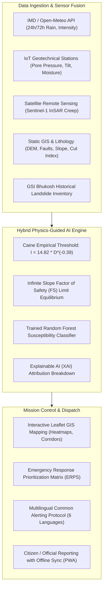

# 🏔️ NER-LandslideWatch: AI-Powered Early Warning & Monitoring Platform

> **An AI-enabled real-time monitoring and early warning platform designed to predict, monitor, and mitigate landslide hazards across the 8 states of the North Eastern Region (NER) of India.**

---

## 📌 1. Project Background & Need in NER

The **North Eastern Region (NER)** of India (Assam, Meghalaya, Arunachal Pradesh, Sikkim, Nagaland, Manipur, Mizoram, and Tripura) is among the most landslide-prone mountainous domains in the world. Rapid tectonic uplift, high annual rainfall (including wettest places on Earth like Cherrapunji and Mawsynram), steep slopes, fragile sedimentary/metamorphic lithology (e.g. Disang shales, Daling phyllites), and extensive anthropogenic road cutting create acute vulnerability.

Disasters like the **Tupul railway landslide in Manipur (2022)**, the **Haflong hill sinking in Assam (2022)**, the recurring washouts of **NH-29 at Dzüdza/Pagla Pahar in Nagaland**, and **NH-10 in Sikkim** consistently sever lifeline connectivity, isolate remote villages, and damage critical infrastructure. 

**NER-LandslideWatch** shifts disaster management from **reactive manual reporting** to **proactive, predictive, AI-driven real-time early warning**.

---

## 🚀 2. System Architecture & Core Capabilities



### Key Modules:
1. **Multimodal Data Fusion**:
   - Dynamic rainfall (24h cumulative, 72h antecedent, hourly intensity).
   - In-situ geotechnical sensors (volumetric soil moisture %, piezometer pore pressure in kPa, inclinometer tilt degrees).
   - Satellite InSAR radar deformation rates (mm/yr) from Sentinel-1.
   - Anthropogenic cut-slope indexing and proximity to active fault lineaments.
2. **Hybrid Physics-Guided AI Hazard Model**:
   - Evaluates empirical Intensity-Duration (I-D) thresholds ($I = \alpha D^{-\beta}$).
   - Computes limit-equilibrium Factor of Safety ($FS$).
   - Blends predictions with a Scikit-Learn Random Forest ensemble (calibrated ROC-AUC > 0.90).
   - Provides Explainable AI (XAI) feature importance breakdowns.
3. **Interactive GIS Cartography (Leaflet.js)**:
   - High-risk heat zones with dynamic severity overlays (Critical, High, Moderate, Low).
   - Lifeline mountain highways (NH-10, NH-29, NH-06, NH-37, etc.) with real-time passability status, detour routes, and clearance machinery standby locations.
   - Monitored vulnerable villages and assigned evacuation relief shelters.
4. **Offline-First PWA & Citizen Science Portal**:
   - Field officials and citizens can submit geo-tagged incident reports (tension cracks, rockfall, debris flow, water seepage).
   - Low-network resilience: stores submissions in browser offline storage (`localStorage`/`IndexedDB`) and automatically syncs when cellular or LoRa mesh coverage is re-established.
5. **Multilingual Emergency Alerts & Dispatch**:
   - Generates CAP-compliant emergency broadcast messages in **6 regional languages**: English, Hindi, Assamese (অসমীয়া), Bengali (বাংলা), Manipuri/Meitei (মৈতৈলোন্), and Mizo (Mizo ṭawng).
6. **Emergency Response Prioritization Score ($ERPS$)**:
   - Calculates urgency score: $ERPS = \text{Hazard Probability} \times \log_{10}(\text{Population}) \times \text{Highway Severance Factor}$.
   - Ranks settlements to optimize deployment of SDRF, NDRF, and emergency relief convoys.

---

## 📂 3. Directory Layout

```
ner-landslide-early-warning/
├── app/
│   ├── main.py                  # FastAPI application entrypoint & REST routing
│   ├── config.py                # Regional bounds & threshold constants
│   ├── models/
│   │   └── schemas.py           # Pydantic data schemas
│   ├── ml/
│   │   ├── train_model.py       # Random Forest training script & synthetic generator
│   │   ├── hazard_predictor.py  # Hybrid Physics-AI inference engine
│   │   └── trained_model.joblib # Serialized model artifact
│   ├── services/
│   │   ├── weather_service.py   # Open-Meteo live rainfall & scenario injector
│   │   ├── sensor_service.py    # IoT geotechnical telemetry & 24h curves
│   │   ├── gis_service.py       # GeoJSON cartographic data provider
│   │   ├── report_service.py    # Field report management & AI validation
│   │   └── alert_service.py     # Multilingual warnings & ERPS ranking
│   ├── static/
│   │   ├── css/custom.css       # Mission control styling & pulsing badges
│   │   ├── js/
│   │   │   ├── app.js           # Core frontend app logic & tab controller
│   │   │   ├── map.js           # Leaflet GIS cartography & layer overlays
│   │   │   ├── charts.js        # Dual-axis telemetry & XAI attribution charts
│   │   │   └── offline_sync.js  # PWA offline queue & sync manager
│   │   ├── manifest.json        # PWA installation manifest
│   │   └── sw.js                # Service Worker for offline app caching
│   └── templates/
│       └── index.html           # Full Mission Control & GIS Dashboard UI
├── data/
│   ├── ner_districts.json       # Topography & demographic data for 8 NER zones
│   ├── road_networks.json       # Lifeline highways with status & detours
│   ├── historical_landslides.json # GSI/NASA catalog of major NER disasters
│   └── sensor_stations.json     # IoT geotechnical sensor node attributes
├── tests/
│   └── test_prediction.py       # Comprehensive automated test suite
├── run.py                       # Root launcher
├── requirements.txt             # Dependency specification
└── README.md                    # Project documentation
```

---

## ⚙️ 4. Quickstart Guide

### Prerequisites
- Python 3.10+ (Python 3.11 recommended)

### 1. Install Dependencies
```bash
pip install -r requirements.txt
```

### 2. (Optional) Re-train the Machine Learning Model
```bash
python -m app.ml.train_model
```

### 3. Run the Automated Test Suite
```bash
python -m unittest discover tests
```

### 4. Launch the Web Platform
```bash
python run.py
```
Open your browser and navigate to:
- **Operations Dashboard**: `http://127.0.0.1:8000`
- **Interactive OpenAPI Documentation**: `http://127.0.0.1:8000/docs`

---

## 🧪 5. Testing Disaster Scenarios

From the top navigation bar, use the **Scenario Selector** to test how the platform reacts under different regional weather events:

1. **Live Satellite / Open-Meteo**: Ingests real-time ECMWF weather predictions for the North East.
2. **Extreme Cloudburst (218mm)**: Simulates a catastrophic cloudburst over Dima Hasao, East Khasi Hills, and Sikkim, triggering red alerts, Caine threshold breaches, and mandatory evacuation orders.
3. **5-Day Monsoon Saturation (415mm)**: Simulates prolonged antecedent monsoon rain that drives soil moisture to > 90% and Factor of Safety below 1.0.
4. **Dry / Stable Baseline**: Demonstrates nominal conditions during post-monsoon winter months.

---

## 🌐 6. Multilingual Emergency Notification Sample

### English (EN)
```
[LANDSLIDE EARLY WARNING ALERT - CRITICAL]
CRITICAL EMERGENCY: Severe landslide imminent in Kohima (Nagaland). Heavy rain (195mm) and critical slope saturation detected. Evacuate Dzüdza immediately to Kohima Stadium. Avoid NH-29.
Call District Control Room: 0370-2290050 or SDRF: 1077. Follow official DDMA directives.
```

### Assamese (অসমীয়া)
```
[ভূমিস্খলনৰ পূৰ্ব সতৰ্কবাৰ্তা - CRITICAL]
জৰুৰী সতৰ্কবাৰ্তা: Dima Hasao জিলাত (Assam) ভয়ংকৰ ভূমিস্খলনৰ প্ৰবল সম্ভাৱনা। প্ৰৱল বৰষুণ (145mm) আৰু পাহাৰীয়া মাটি খহি পৰাৰ আশংকা। Jatinga Slopesৰ লোকসকলক তৎক্ষণাৎ Haflong Town Stadiumলৈ যাবলৈ নিৰ্দেশ দিয়া হৈছে। NH-27 ব্যৱহাৰ নকৰিব।
জিলা নিয়ন্ত্ৰণ কক্ষ 03673-236324 বা SDRF ১০৭৭ লৈ যোগাযোগ কৰক।
```

### Manipuri / Meitei (মৈতৈলোন্)
```
[চিং কায়বগী অঙনবা চেকশিন ৱাফম - CRITICAL]
অকনবা চেকশিন ৱাফম: Noney (Manipur) দা চাউনা চিং কায়বগী খুদোংথিবা লৈরে। নোং কন্না চুবা (164mm) অমসুং লৈমাইল হন্থরকপা। Tupul Railway Yard Slopesগী মীয়াম্না তপথনা Noney District Headquarter Complexদা চংশিনবিয়ু। NH-37 চৎপদা চেকশিনবিয়ু।
ডিস্ট্রিক্ট কন্ত্রোল রুম 03874-267022 নত্রগা SDRF ১০৭৭ দা পাউ পীবিয়ু।
```

---

## 🔒 7. Offline Resilience in Remote Hill Areas

In remote mountainous pockets of Arunachal Pradesh, Nagaland, and Manipur, cellular connectivity is frequently disrupted. The platform incorporates:
- **Service Worker (`sw.js`)**: Caches static assets, stylesheets, and cartographic scripts for offline boot.
- **Client Offline Storage Queue (`offline_sync.js`)**: Stores citizen/field official reports in browser storage when disconnected.
- **Automated Sync Engine**: Detects reconnection (`window.ononline`) and batches queued reports to `/api/reports/batch-sync`, updating the central GIS dashboard without losing field observations.
